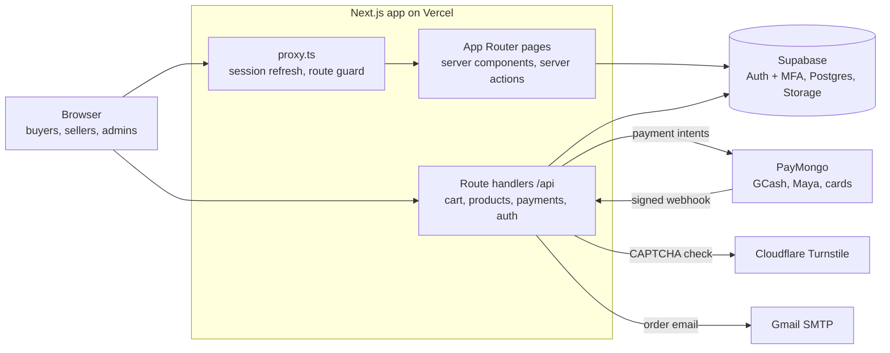
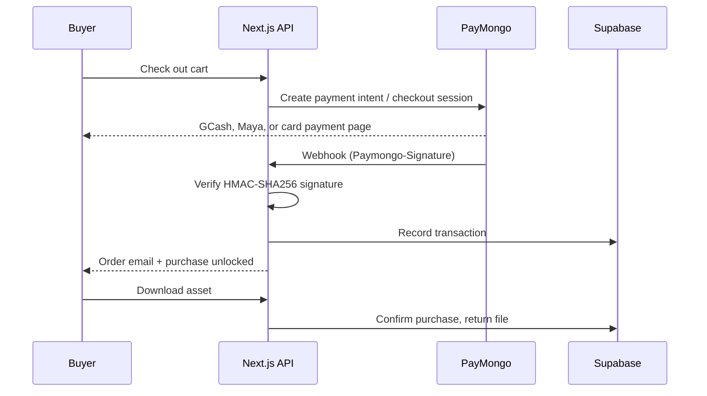

<p align="center">
  
</p>

# Pithos

**A marketplace for 3D and digital assets: sellers upload model packages, buyers check out with GCash, Maya, or card through PayMongo, and admins run the store from a dashboard.**


Pithos is a team project (Group 7) built from March to May 2026. It is a full-stack e-commerce app with three roles: **buyers**, **sellers**, and **admins**.

<!-- Live demo: the Vercel deployment at https://pithos-eta.vercel.app is currently offline. Restore this line once it is redeployed:
**Live demo:** [pithos-eta.vercel.app](https://pithos-eta.vercel.app)
-->

<!-- Screenshot placeholder: add screenshots of the storefront, product page, and seller dashboard at docs/images/, then uncomment:

-->

## Features

### Storefront
- Home page with banners that admins edit from the dashboard, category browsing, and an infinite-scroll product feed.
- Product listing with search, filters, and sorting. Product pages with media, reviews, and suggested items.
- Public seller pages and a "become a seller" application flow.

### Buyers
- Cart with live item count and suggestions, and favorites.
- **Checkout through PayMongo** with GCash, Maya, or card. Payment status is confirmed by a signature-verified webhook, then an order email is sent.
- Purchase history with downloadable PDF receipts. Purchased asset packages can be downloaded, and the server checks each download against the buyer's transactions.
- Account pages for personal info and security, including **TOTP two-factor authentication**.

### Sellers
- Upload asset packages (`.zip`, `.blend`, `.fbx`, `.obj`, `.gltf`/`.glb`, `.stl`, and more, up to 50 MB) with preview photos.
- Manage listings, view orders, and see a sales dashboard with charts.
- Payout settings. Account numbers are encrypted (AES-256) before storage.

### Admins
- Dashboard with store statistics, user management, and audit logs.
- Payment gateway settings, site content (banners and images), and system configuration such as per-role session timeouts and support contact details.

### Security
- Supabase Auth with optional TOTP MFA, plus Cloudflare Turnstile CAPTCHA on login and sign-up.
- Role-based route protection in the Next.js request proxy, with session refresh on every request.
- Input sanitization (DOMPurify), upload validation, and encryption of sensitive settings.
- Idle-session timeout with a warning, audit logging of admin actions, and a cookie-consent banner.

## Tech stack

| Area | Tools |
| --- | --- |
| Framework | Next.js 16 (App Router, server actions, route handlers), React 19, TypeScript |
| UI | Tailwind CSS, shadcn/ui and Radix primitives, Framer Motion, lucide-react, Sonner toasts |
| Data | Supabase: Postgres, Auth (with MFA), Storage via `@supabase/ssr` |
| Payments | PayMongo API (payment intents, checkout sessions, webhooks) |
| Other | Cloudflare Turnstile, Nodemailer (Gmail SMTP), TanStack Table, Chart.js, jsPDF |
| Hosting | Vercel |

## Architecture



### Checkout flow



## My role

I wrote the largest share of the code (about 64 of 141 commits). I owned:

- **Payments:** the PayMongo integration, including payment intents, checkout sessions, the signature-verified webhook, and order emails.
- **Admin section:** the dashboard, user management, audit logs, site content, and system configuration.
- **Data layer:** the Supabase server, client, and admin clients, plus the session proxy and audit helper.
- **Cart and checkout:** cart APIs, the checkout pages, and the purchase-gated download route.
- **Account security:** TOTP MFA setup.

My teammates built the rest. Lark Bolotaolo led much of the seller section, Charles Jeramy De Padua worked on the buyer account pages, and Cj and GRCIMDRN contributed across the admin, cart, payments, and idle-session features.

## Getting started

### Prerequisites

- Node.js 20+ and npm
- A Supabase project (Auth, Postgres, Storage)
- PayMongo **test-mode** keys, Cloudflare Turnstile keys, and a Gmail app password

### Install and run

```bash
git clone https://github.com/klacom/pithos.git
cd pithos
npm install
cp .env.example .env.local    # fill in your own values
npm run dev                   # http://localhost:3000
```

The database schema is not in this repository. The app expects Supabase tables such as `users`, `user_profiles`, `products`, `categories`, `cart`, `favorites`, `reviews`, `transactions`, `homepage_blocks`, `session_policies`, and `user_sessions`, plus an `assets_storage` bucket.

To test PayMongo webhooks locally, expose `/api/payments/webhook` with a tunnel and register that URL in the PayMongo dashboard.

### Environment variables

See [`.env.example`](.env.example). Key names only; never commit real values.

| Key | Purpose |
| --- | --- |
| `NEXT_PUBLIC_SUPABASE_URL`, `NEXT_PUBLIC_SUPABASE_PUBLISHABLE_KEY` | Supabase project (public) |
| `SUPABASE_SERVICE_ROLE_KEY` | Server-only admin client for Storage uploads |
| `PAYMONGO_PUBLIC_KEY`, `PAYMONGO_SECRET_KEY` | PayMongo API |
| `NEXT_PUBLIC_PAYMONGO_WEBHOOK_SECRET` | Verifies PayMongo webhook signatures |
| `NEXT_PUBLIC_TURNSTILE_SITE_KEY`, `TURNSTILE_SECRET_KEY` | Cloudflare Turnstile CAPTCHA |
| `ENCRYPTION_KEY` | 32-character AES-256 key for sensitive fields |
| `GMAIL_APP_PASSWORD` | Order-confirmation emails |

## Project structure

```text
pithos/
├── app/
│   ├── (main)/(public)/        # storefront, product pages, seller pages
│   ├── (main)/(protected)/     # buyer, seller, admin, cart and checkout
│   ├── api/                    # route handlers: auth, cart, products, payments
│   └── auth/                   # login, sign-up, password reset, callbacks
├── components/                 # UI by area (admin, seller, auth, navbar, ui)
├── lib/
│   ├── supabase/               # server/client/admin clients, session proxy, audit
│   ├── payments/paymongo/      # PayMongo client
│   ├── seller/                 # asset upload rules and storage
│   └── crypto.ts, totp.ts, sanitization*.ts
├── proxy.ts                    # request proxy: session refresh, route guard
└── public/                     # logos, payment logos
```

## Team

Group 7:

- **Klarenz Cobie O. Manrique** ([@klacom](https://github.com/klacom))
- **Charles Jeramy C. De Padua** ([@baldopadua](https://github.com/baldopadua))
- **Lark Bolotaolo**
- **Cj**
- **GRCIMDRN**

## Other projects

- [EcoPin](https://github.com/klacom/ecopin_backend_node): crowdsourced environmental reporting and cleanup dispatch for Pasig City (capstone)
